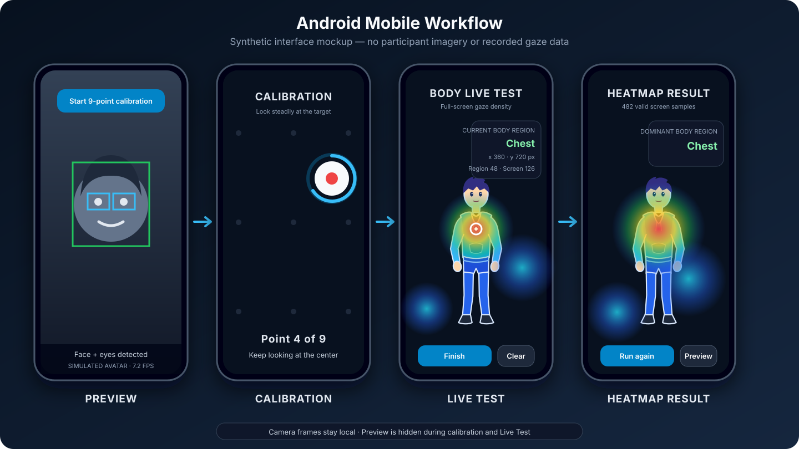

# GazeFollower: Desktop Experiments and Android Gaze Tracking

This repository extends [the original GazeFollower project](https://github.com/GanchengZhu/GazeFollower) with a structured desktop experiment workflow and an Android implementation for on-device gaze tracking.

The first mobile target is the **Samsung Galaxy A10 (SM-A105M)** running **Android 9** with a 32-bit `armeabi-v7a` userspace.

> This is a research prototype. Live gaze feedback and heatmaps are intended for qualitative inspection, not clinical use or accuracy measurement.

## Contents

- [What We Added](#what-we-added)
- [Mobile Workflow](#mobile-workflow)
- [Desktop Workflow](#desktop-workflow)
- [Android Quick Start](#android-quick-start)
- [Desktop Quick Start](#desktop-quick-start)
- [Data Outputs](#data-outputs)
- [Project Structure](#project-structure)
- [Testing](#testing)
- [Current Status](#current-status)
- [Privacy](#privacy)
- [Acknowledgements and License](#acknowledgements-and-license)

## What We Added

### Android deployment

- Front-camera preview with CameraX.
- MediaPipe face landmarks and face/eye region tracking.
- Single-frame inference with the existing `base.mnn` model.
- Native MNN inference through a Kotlin/C++ JNI bridge.
- Nine-point mobile calibration with animated targets.
- Calibrated gaze-point display.
- Human-body Live Test with a full-screen gaze heatmap.
- Current body-region feedback, screen coordinates, and sample counts.
- A result screen showing the dominant body region.

### Desktop experiment workflow

- A launcher for participant and session setup.
- Independent Validation and Live Test modes.
- Validation without gaze feedback to reduce measurement bias.
- Human-body gaze feedback and heatmap visualization.
- Session-based CSV, JSON, and image outputs.
- Configurable face alignment, calibration method, display, and processing mode.

### Shared inference behavior

The desktop and Android implementations use the same core model assumptions:

- Face input: `224 × 224`.
- Left and right eye inputs: `112 × 112`.
- Right-eye crop is horizontally flipped.
- Image values use BGR channel order and `[0, 1]` normalization.
- Face and eye rectangles are provided as normalized model inputs.
- Android uses the same `base.mnn` model stored under `gazefollower/res/model_weights/`.

## Mobile Workflow



*Synthetic UI mockup with a male vector anime character. It contains no participant image or recorded gaze data.*

| Stage | Behavior |
| --- | --- |
| **1. Preview** | Shows the front camera, face box, eye boxes, frame count, and FPS. |
| **2. Calibration** | Hides the camera preview while analysis continues. Nine animated targets collect personal calibration samples. |
| **3. Calibration Result** | Confirms calibration and offers Live Test or recalibration. |
| **4. Body Live Test** | Displays a body diagram, calibrated gaze marker, full-screen heatmap, body region, coordinates, and sample counts. |
| **5. Heatmap Result** | Freezes the heatmap and reports the dominant body region. |

The heatmap accepts every valid gaze prediction inside the screen. Body transparency is used only to classify the current body region; it does not limit heatmap coverage.

## Desktop Workflow

The desktop launcher follows this sequence:

```text
Session setup → Camera preview → Personal calibration
                                  ├─ Validation → Accuracy results
                                  └─ Live Test  → Body heatmap results
```

### Validation

- Uses independent target points.
- Hides gaze predictions during measurement.
- Calculates pixel error, valid rate, and summary statistics.

### Live Test

- Displays a front-facing body model.
- Shows the current gaze location and body region.
- Accumulates a qualitative gaze heatmap.
- Records frame-level predictions and session statistics.

## Android Quick Start

### Requirements

- Android Studio or Android SDK command-line tools.
- JDK 17.
- Android SDK 34.
- CMake 3.22.1 and Android NDK.
- A USB-debuggable Android device.

The current native package targets `armeabi-v7a` for the Galaxy A10.

### Build

```bash
cd mobile/android
ANDROID_USER_HOME="$PWD/.android-home" ./gradlew assembleDebug
```

The first native build downloads the pinned MNN Android library and headers. Later builds reuse the local Gradle/CMake cache.

### Install and launch

```bash
adb devices -l
adb install -r app/build/outputs/apk/debug/app-debug.apk
adb shell am start -n com.gazefollower.mobile/.MainActivity
```

More Android-specific details are available in [mobile/android/README.md](mobile/android/README.md).

## Desktop Quick Start

The tested macOS setup uses Python 3.10 on Apple Silicon.

```bash
python3.10 -m venv .venv
source .venv/bin/activate
python -m pip install --upgrade pip
python -m pip install -r requirements-macos-arm64.txt
python example/gui_launcher.py
```

On macOS, the launcher can also be opened by double-clicking `run_gui.command`.

## Data Outputs

Desktop sessions are stored under:

```text
results/<participant_id>/<session_id>/
```

### Validation session

| File | Contents |
| --- | --- |
| `gaze_samples.csv` | Frame-level SDK output. |
| `validation.csv` | Targets, predictions, validity, and pixel error. |
| `summary.json` | Configuration and aggregate metrics. |
| `validation_plot.png` | Target and predicted-gaze visualization. |
| `calibration_model/` | Session-specific calibration model. |

### Live Test session

| File | Contents |
| --- | --- |
| `gaze_samples.csv` | Frame-level SDK output. |
| `live_predictions.csv` | Predicted coordinates, body region, and tracking state. |
| `live_heatmap.png` | Final qualitative heatmap. |
| `summary.json` | Session duration, valid rate, FPS, and region statistics. |

Android CSV/JSON export is not implemented yet.

## Project Structure

```text
GazeFollower/
├── gazefollower/                 # Original Python package and shared assets
├── example/
│   ├── gui_launcher.py           # Desktop experiment launcher
│   └── experiment_runner.py      # Validation and Live Test workflows
├── mobile/android/               # Android application
│   └── app/src/main/
│       ├── java/                 # Camera, MediaPipe, calibration, and UI
│       └── cpp/                  # MNN JNI bridge
├── tests/                        # Desktop tests
└── docs/images/                  # Documentation-only synthetic graphics
```

## Testing

### Android unit tests

```bash
cd mobile/android
ANDROID_USER_HOME="$PWD/.android-home" ./gradlew testDebugUnitTest
```

### Android device tests

```bash
cd mobile/android
ANDROID_USER_HOME="$PWD/.android-home" ./gradlew connectedDebugAndroidTest
```

`connectedDebugAndroidTest` may remove the application after testing. Reinstall the debug APK before manual testing if necessary.

### Desktop tests

```bash
pytest tests
```

## Current Status

| Component | Status |
| --- | --- |
| Desktop preview and calibration | Complete |
| Desktop validation and exports | Complete |
| Desktop human-body Live Test | Complete |
| Android camera and MediaPipe tracking | Complete |
| Android `base.mnn` inference | Complete |
| Android nine-point calibration | Complete |
| Android full-screen Live Test heatmap | Complete |
| Android validation workflow | Planned |
| Android CSV/JSON and heatmap export | Planned |
| Android calibration persistence | Planned |

## Privacy

- Documentation must not include participant faces or identifiable test-session screenshots.
- The workflow image in this README is a synthetic vector mockup.
- Camera frames are processed locally by the current prototype.
- Researchers are responsible for consent, data handling, retention, and institutional requirements.

## Acknowledgements and License

This project is derived from [GanchengZhu/GazeFollower](https://github.com/GanchengZhu/GazeFollower). The original project provides the gaze-tracking architecture, model integration, calibration framework, and Python API on which this work is based.

Please cite the upstream project when using this derivative work:

```bibtex
@article{zhu2025gazefollower,
  title={GazeFollower: An open-source system for deep learning-based gaze tracking with web cameras},
  author={Zhu, Gancheng and Duan, Xiaoting and Huang, Zehao and Wang, Rong and Zhang, Shuai and Wang, Zhiguo},
  journal={Proceedings of the ACM on Computer Graphics and Interactive Techniques},
  volume={8},
  number={2},
  pages={1--18},
  year={2025},
  publisher={ACM New York, NY}
}
```

This repository retains the upstream **CC BY-NC-SA 4.0** license. See [LICENSE-CC-BY-NC-SA](LICENSE-CC-BY-NC-SA).
